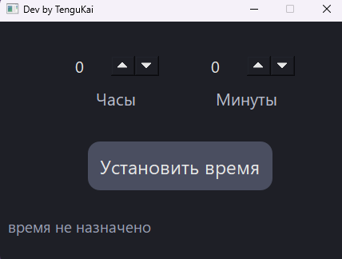
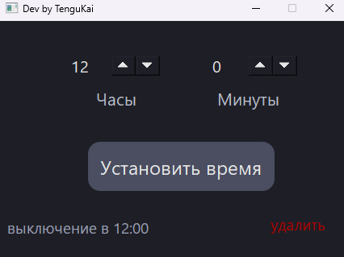
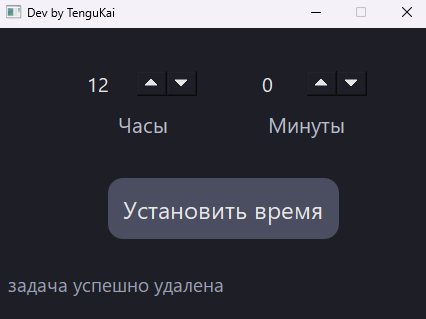

# killPCtime
приложение для назначения процесса выключения компьютера в назначенное время.

## Стек технологий
выполнено на C++ qt, основой проекта стала библиотека QProcess для создания/удаления процессов windows с помощью утилиты schtasks, используется параметр daily из-за чего процесс срабатывает каждый день в назначенное время

## Руководство использования

### 1. Назначение таймера
При открытии проекта пользователь выбирает нужное ему время выключения, нажав на "установить время"

    

### 2. Контроль статуса
Если время уже установлено то время выключения также будет указано в левом нижнем углу

    

### 3. Отмена выключения
Также предусмотрено удаление процесса, для этого достаточно нажать на "удалить"

    

## Запуск проекта
1. Скачайте архив **`build.rar`** из репозитория.
2. Распакуйте архив в любое удобное место.
3. Перейдите в распакованную папку `build` и запустите исполняемый файл killPCtime.exe

  

